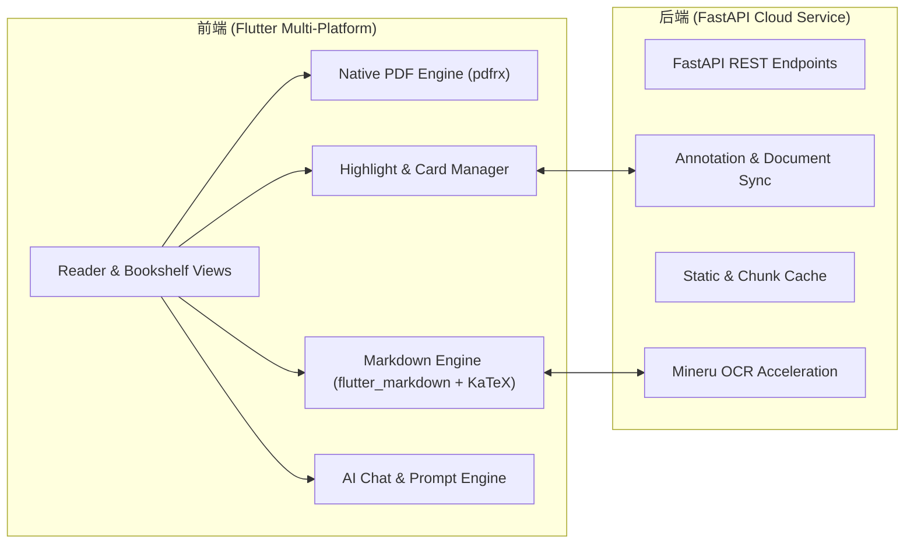

# ReadN

<p align="center">
  <strong>新一代面向科研与深度学习的跨平台 PDF / Markdown 智能阅读工作台</strong><br>
  <em>AI-Powered Cross-Platform Scholarly PDF Reader & Knowledge Workspace</em>
</p>

<p align="center">
  
  
  
  
  
</p>

---

## 📖 简介 (Introduction)

**ReadN**（Read + Note + Next）是一款专为学术论文研读、专业技术文档阅读及知识精细化沉淀而设计的现代化阅读器。

针对传统 PDF 阅读器公式无法提取、排版僵硬、批注与知识管理脱节等痛点，ReadN 提供了**双模态阅读引擎**，结合内置的高性能 LaTeX 公式交互、深度 Mineru 智能解析、多端云同步以及多模型 AI 辅助，让学术论文与大部头技术书籍的阅读更专注、更流畅。

---

## ✨ 核心特性 (Key Features)

- 📑 **双模态阅读引擎**
  - **原生 PDF 模式**：基于流式加载与虚拟化视口渲染，即便面对数百兆的大型文献也能秒级开启、拒绝卡死。
  - **Markdown 智能重排模式**：将扫描件/复杂排版 PDF 一键转化为结构清晰的 Markdown 文档，支持段落重排、目录自动解析与图片自适应嵌入。
- 🧮 **深度 LaTeX 公式交互与高亮**
  - 原生渲染行内公式（`$...$`）与展示公式（`$$...$$`），字符级垂直居中对齐。
  - **首创公式-文本混合荧光高亮**：选区跨越多个数学公式时自动智能切片，保留精致发光胶囊视觉的同时确保文本流式折行，杜绝排版断裂。
  - 支持公式源码一键复制与公式级划词提问。
- 💡 **精细化学术批注与知识卡片**
  - **多色荧光笔**：支持多色高亮、自动容错锚定。
  - **知识卡片 (Knowledge Cards)**：划词一键提炼概念，生成可视化卡片并汇聚于侧边栏。
  - **边读边记 (Margin Notes)**：支持行间即时注解与富文本沉淀。
  - **多端实时同步**：毫秒级本地缓存，联网状态下自动双向云同步。
- 🤖 **内置深度 AI 学术伴读助手**
  - 支持自定义接入 OpenAI、DeepSeek、Moonshot (Kimi) 等兼容 OpenAI 协议的模型。
  - **思维链可视化**：完整展现模型的深度思考与推理过程（Reasoning State）。
  - 支持划词即问、长篇综述总结、知识卡片自动提炼。
- ⚡ **智能 OCR 与无缝分片**
  - 深度整合 Mineru 高性能解析引擎。
  - 针对单文件 200MB / 200 页限制，后台静默自动切片并发解析并平滑合并，提供上传速率与全流程进度感知。

---

## 🏗️ 架构概览 (Architecture)



- **Frontend**：Flutter 3.47+ (Dart 3.13+)，支持 Web、Windows x64 桌面端及 Android 移动端。
- **Backend**：FastAPI (Python 3.10+)、Uvicorn、SQLite / PostgreSQL。
- **Deployment**：支持 Docker 化部署或一键部署至轻量云服务器。

---

## 🚀 快速上手 (Quick Start)

### 1. 环境准备
- [Flutter SDK](https://flutter.dev/docs/get-started/install) (>= 3.24.0)
- [Python](https://www.python.org/) (>= 3.10)

### 2. 后端服务启动
```bash
# 1. 进入后端目录
cd backend

# 2. 安装 Python 依赖
pip install -r requirements.txt

# 3. 启动开发服务器
uvicorn app.main:app --host 0.0.0.0 --port 18903 --reload
```

后端服务启动后，可在浏览器访问 `http://localhost:18903/docs` 查看交互式 API 文档。

### 3. 前端启动与构建
```bash
# 1. 进入前端目录
cd frontend

# 2. 获取依赖
flutter pub get

# 3. 本地调试 (Web / 桌面端)
flutter run -d chrome
# 或运行 Windows 桌面端
flutter run -d windows

# 4. 生产打包
flutter build web --release      # Web 发布包
flutter build windows --release  # Windows 安装包
flutter build apk --release      # Android APK
```

---

## 📦 版本控制与部署 (Versioning & Deployment)

ReadN 内置了自动化版本管理规范：

- **版本自增**：运行 `python scripts/bump_version.py` 或通过 Git 提交钩子自动更新 Semantic Version（当前版本 `v1.1.4`）。
- **一键服务器部署**：
  ```bash
  python scripts/deploy_to_hk.py
  ```
  自动化完成前端产物同步、TAR 打包、SCP 上传、远程解压以及 systemd 服务无缝热重启。

---

## 📝 开源协议 (License)

本项目采用 [MIT License](LICENSE) 开源协议。

